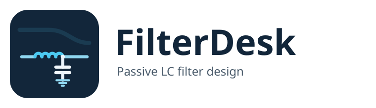

<p align="center">
  <picture>
    <source media="(prefers-color-scheme: dark)" srcset="assets/logo-wordmark-dark.png">
    
  </picture>
</p>

[](https://github.com/fsclavo/filter-desk/actions/workflows/test.yml)
[](https://github.com/fsclavo/filter-desk/releases)

Open-source desktop application for **passive lumped-element RF/electronic filter
synthesis and analysis**. FilterDesk designs low-pass, high-pass, band-pass, and
band-stop LC filters, shows you how they actually behave, accounts for real-world
tolerances and parasitics, and exports the result to Touchstone, CSV, SPICE, or an
image.

> An independent implementation of classical network-synthesis theory and
> practical LC filter design.

## Built for radio amateurs and RF builders

FilterDesk is a workbench companion for **ham radio homebrew, repair, antenna
projects and station filters**. It is not only a filter calculator: it helps you
go from an amateur-band requirement to a schematic, real component values, a
build sheet and a comparison with a VNA measurement.

Typical amateur-radio jobs:

- **Transmit low-pass filter** for an HF/VHF/UHF transmitter or QRP rig.
- **Receive band-pass filter** for a noisy HF band or a contest receiver.
- **AM/FM broadcast rejection** with a band-stop notch.
- **Output transformer, unun or balun** for an antenna or a matching network.
- **Toroid and air-core coil** turns, wire gauge, DCR and saturation checks.
- **Microstrip/stub** sizing for a PCB filter or matching section.
- **Distributed low-pass** conversion to microstrip lines for a PCB build.
- **VNA comparison and tuning** of a filter you already built.

## New to filter design? Start in five minutes

You do not need to know the synthesis mathematics first.

1. Download the Windows installer, Linux AppImage or Debian/Ubuntu package from
   [Releases](https://github.com/fsclavo/filter-desk/releases) and open FilterDesk.
2. For a **receive filter**, open **Design → Band filter wizard…**, choose the
   band, **Guided design** and **Band-pass**, set the rejection, then press
   **Design**.
3. For a quick **transmit low-pass**, use **Design → Band filter wizard…**,
   choose **Quick preset**, the band and **Transmit LPF**.
4. Use **Design → Snap to E-series…** to turn ideal values into standard parts.
5. Export the **build sheet/BOM** and compare against your measurement with the
   Touchstone import and the measured overlay.

The status strip and the **Help → Model confidence** window tell you which
results are validated, estimated or experimental. Start with the model, then
verify the real build.

## Common amateur-radio tasks

| Task | Start here |
| --- | --- |
| 40 m / 20 m receive band-pass | **Design → Band filter wizard…** → **Guided design** → **Band-pass** |
| HF transmitter low-pass | **Design → Band filter wizard…** → **Quick preset** → **Transmit LPF** |
| AM/FM broadcast notch | **Design → Band filter wizard…** → **Band-stop** |
| 1:1 choke, 1:4 balun, 1:49 unun | **Tools → Transformer / balun / unun…** |
| Toroid/air-core coil | **Tools → Coil calculator…** |
| PCB microstrip, stub, quarter-wave | **Tools → Microstrip line…** |
| Coax stub notch for VHF/UHF | **Tools → Coaxial stub notch…** |
| Low-pass filter as microstrip lines | **Design → Distributed microstrip realization…** |
| Compare or trim a built filter | **File → Import → Touchstone…**, then **Design → Tune to VNA measurement…** |

## Glossary for newcomers

- **Passband / stopband** — frequencies the filter should pass / reject.
- **Cutoff** — the transition frequency; its exact definition is shown in the UI.
- **S11 / S21** — input reflection and forward transmission (often shown in dB).
- **VSWR / return loss** — how well the filter matches 50 Ω (or another system).
- **E-series** — standard commercial component values (E6, E12, E24, …).
- **Toroid** — a ring-shaped magnetic core used for inductors and transformers.
- **Unun / balun** — unbalanced-to-unbalanced / balanced-to-unbalanced transformer.
- **VNA** — vector network analyzer; a measurement instrument for S-parameters.

## En español

FilterDesk también está pensado para **radioaficionados**: sirve para diseñar
filtros pasa-bajos, pasa-altos, pasa-banda y rechazo de banda, calcular
transformadores, baluns/ununs, toroides y líneas microstrip, y comparar el
resultado con mediciones de un VNA. La interfaz está disponible en español y el
flujo recomendado para empezar es **Diseño → Asistente de filtro de banda HF**.
Buscá también “calculadora de filtros para radioaficionados”, “filtro pasa-banda
HF”, “calculadora de toroides” y “diseño de balun/unun”.

## Features

- **Synthesis** of low-pass, high-pass, band-pass, and band-stop LC ladders.
- **Approximation families**: Butterworth, Chebyshev Type I/II, elliptic (Cauer),
  Bessel, Gaussian, Legendre, and constant-*k* / m-derived sections.
- **Analysis** with magnitude, S12/S22, phase, VSWR, group delay, impedance, and
  Smith-chart views, using a fast ladder backend (`abcd`) or a `scikit-rf`
  cross-check.
- **Real-world effects**: finite inductor Q, DCR, self-resonance, DC-bias
  derating, capacitor ESL/ESR, and parasitic capacitance.
- **Transformer / unun / balun calculator**: turns, Lm, flux/saturation and wire
  gauges on the built-in toroid table.
- **Balun / unun designer**: ideal, Guanella/Ruthroff and choke models with
  core/wire, complex-permeability core loss, thermal-rise estimate and
  output-boundary BOM insertion. Integer 1:N² Guanella ratios use an explicit
  multi-line network; 1:4 Ruthroff uses an equal-delay bootstrap network. Both
  TLT kinds can export a SPICE test netlist; Ruthroff is 1:4 step-up.
  Winding options include DCR/leakage estimates and the selected option is
  persisted.
- **Microstrip / distributed calculators**: line width, `eeff`, quarter-wave
  transformer, open/short stubs, substrate presets and first-order loss.
- **Experimental distributed LP synthesis**: order 1–5 Butterworth/Chebyshev-I
  low-pass conversion to microstrip lines; orders 4–5 use a gated numerical fit.
  Includes BOM geometry, microstrip dispersion/open-end fringing and explicit
  model limits.
- **VNA-guided tuning**: import a measured `.s2p` and trim L/C/R values to the
  measured S11/S21 magnitude with bounded least squares.
- **Measurement history**: store multiple captures per project, keep their
  VNA/calibration/reference metadata, inspect provenance/comparison, tune to a
  stored capture and switch the active overlay.
- **Toroid / air-core realization**: turn a synthesized inductor into a physical
  winding (turns, wire gauge, DCR) from the built-in coil calculators.
- **Light/dark/system theme** with remembered window layout.
- **English/Spanish GUI** (applies on restart).
- **QA matrix** and independent LP/HP numerical oracle; see
  [`docs/qa-matrix.md`](docs/qa-matrix.md).
- **E-series snapping** (IEC 60063 E6–E96) to turn ideal values into real parts.
- **Tolerance analysis**: per-component tolerances and a Monte-Carlo envelope
  with yield estimates.
- **Optimization** against limit regions (passband/stopband masks).
- **Component sensitivity** analysis that ranks parts by their effect and
  suggests a tuning direction.
- **Band filter wizard**: Quick LP/HP/BP/BS presets or guided band +
  insertion-loss/rejection requirements → order search → optional E24 snap.
- **Spec-from-circuit update**: manually re-target cutoff/center/bandwidth from
  the measured/analyzed response without silently changing the circuit.
- **Design parameter sweeps** (order, family, frequency, ripple…) into a
  comparison table, with one-click load of a chosen variant.
- **Interactive tuning**: tune components, retune by dragging markers, and scale
  the whole response.
- **Recent projects** menu for the last ten opened/saved filter files.
- **Multiport file tools**: inspect, renumber, terminate and parallel-combine
  Touchstone `.sNp` networks from the CLI.
- **LPF+HPF diplexer**: synthesize both branches, build the combined 3-port,
  report insertion loss/rejection/return loss and export `.s3p`; available in
  the GUI (**Tools → Diplexer LPF+HPF…**) and CLI.
- **Interoperability**: import/export Touchstone (`.s1p`/`.s2p`/`.sNp`), export CSV,
  LTspice-compatible SPICE netlists, and Smith-chart images.
- Both a **desktop GUI** (PySide6) and a scriptable **command-line interface**.

## Download and install

### Prebuilt bundles

Prebuilt packages for Windows and Linux are published on the
[Releases](https://github.com/fsclavo/filter-desk/releases) page:

| Platform | File | Notes |
| --- | --- | --- |
| Windows | `FilterDesk-<ver>-windows-x86_64-setup.exe` | installer with Start Menu/Desktop shortcuts |
| Windows | `FilterDesk-windows-x86_64.zip` | portable bundle |
| Linux | `FilterDesk-x86_64.AppImage` | single-file app (needs **glibc ≥ 2.35**, i.e. Ubuntu 22.04+) |
| Linux | `FilterDesk-linux-x86_64.tar.gz` | portable bundle |
| Debian/Ubuntu | `FilterDesk-<ver>-amd64.deb` | system package; `sudo apt install ./FilterDesk-<ver>-amd64.deb` |

The launcher is GUI-first: double-click it to open the desktop app. Passing CLI
arguments (for example `FilterDesk --version`) uses the command-line interface.

### From source

Requires Python **3.11+** and either [`uv`](https://docs.astral.sh/uv/)
(recommended) or `pip`.

```bash
git clone https://github.com/fsclavo/filter-desk.git
cd filter-desk
uv sync
```

With `pip` instead:

```bash
python -m venv .venv
source .venv/bin/activate      # Windows: .venv\Scripts\activate
pip install .
```

Verify the install:

```bash
uv run filterdesk --version
```

## Quick start

Launch the desktop application:

```bash
uv run filterdesk gui
```

The app opens with a ready-made example (a 7th-order Chebyshev Type I high-pass,
140 MHz cutoff). Edit the fields in the **Specification** panel and press
**Synthesize + Analyze** (`Ctrl+Return`) to see the schematic, component table,
and response plots update.

Prefer the command line? Synthesize and analyze the same filter:

```bash
uv run filterdesk synthesize \
  --spec tests/golden/cheby1_hp_n7_0p01db_140mhz_50ohm/spec.json

uv run filterdesk analyze \
  --spec tests/golden/cheby1_hp_n7_0p01db_140mhz_50ohm/spec.json \
  --export-s2p milestone.s2p --export-csv traces.csv
```

## Search terms

People usually find FilterDesk while looking for a **ham radio filter
calculator**, **HF band-pass filter designer**, **LC low-pass filter calculator**,
**transmitter output filter**, **toroid calculator**, **balun/unun designer**,
**microstrip calculator**, or a **VNA filter tuning** companion.

## Documentation

- **[User Manual](docs/user-manual.md)** — installing, concepts, the GUI,
  workflows, the full CLI reference, and file formats. Start here.
- [Development blueprint](docs/DEVELOPMENT_BLUEPRINT.md) and
  [backlog](docs/BACKLOG.md) — architecture and roadmap (for contributors).
- [packaging.md](docs/packaging.md) — how the release bundles are built.
- [`docs/adr/`](docs/adr/) — architecture decision records and
  [`docs/math/`](docs/math/) — the synthesis math.

## License

Apache-2.0. See [`LICENSE`](LICENSE) and [`NOTICE`](NOTICE).
