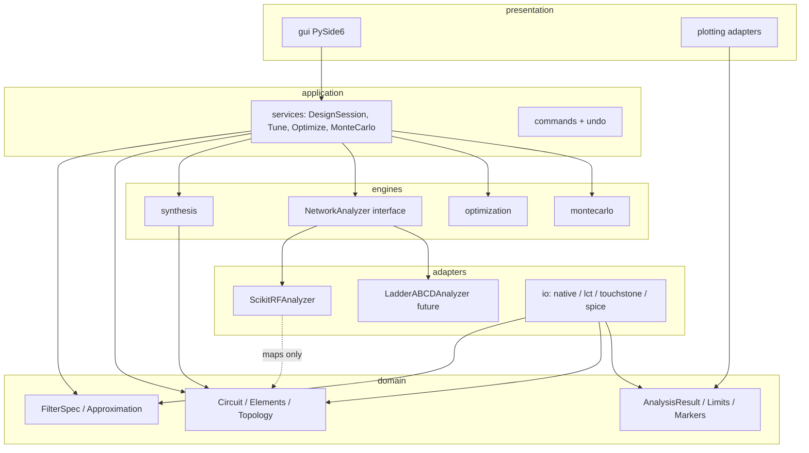
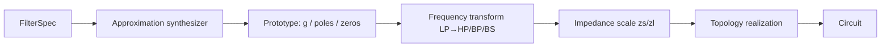
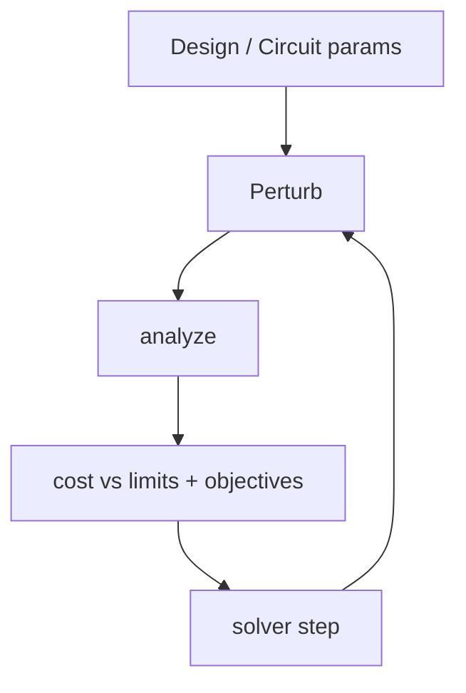
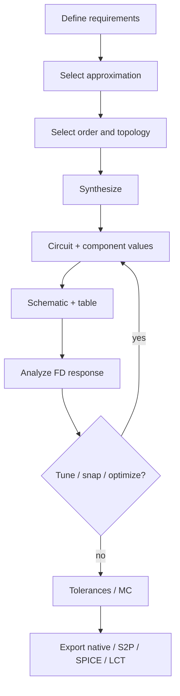

# FilterDesk — Development Blueprint

**Working name:** FilterDesk  
**Package name (proposed):** `filterdesk`  
**Document status:** Living blueprint. Phases 0–5b complete — see `docs/phase0/` … `docs/phase5b/`.  
**Date:** 2026-03-29  

> **Legal posture.** This project is an independent implementation built from classical filter theory. Proprietary third-party software must not be copied or reverse-engineered beyond what is lawful for interoperability with public, documented file formats.

---

## Legend for decision types

| Tag | Meaning |
| --- | --- |
| **Theory** | Established RF/filter-network engineering |
| **Library** | Documented capability of a dependency |
| **Recommendation** | Architectural choice of this blueprint |
| **Assumption** | Plausible but not yet verified in this project |
| **Open** | Explicit investigation required before/during Phase 0–N |

---

## 1. Executive summary

FilterDesk will be a **cross-platform desktop application** for **passive lumped-element LC filter synthesis and frequency-domain analysis**, aimed at progressive functional parity with ELSIE’s *filter-design* workflow, without becoming a general RF circuit simulator.

**Core principle:** own a **canonical domain model** (specification → synthesis → circuit → analysis results). Use **scikit-rf as an analysis backend adapter**, not as the domain. Keep **GUI**, **math**, and **I/O** strictly separated.

**Recommended stack:** Python ≥3.11, PySide6/Qt 6, NumPy, SciPy, scikit-rf (adapter), PyQtGraph (interactive plots) + Matplotlib (export/Smith helpers), pytest, Ruff, mypy, uv, PyInstaller + AppImage (Linux first).

**First engineering milestone (not GUI):** synthesize and analyze a known reference filter (e.g. 7th-order Chebyshev Type I high-pass, 0.01 dB ripple, 140 MHz, 50 Ω/50 Ω) and match golden component values and response metrics within defined tolerances.

**Highest technical risks:** (1) elliptic/Cauer and asymmetric Z correctness; (2) undocumented `.lct` format; (3) synthesis↔analysis mismatch; (4) interactive performance if every retune goes through heavy Circuit construction.

**Deferred by design:** transformers, coupled inductors, transmission lines, stubs, distributed equivalents, full microwave structures, time-domain analysis.

---

## 2. Product vision

FilterDesk helps RF engineers, technicians, and radio amateurs:

1. Specify a filter (response type, approximation, order/edges, Zsource/Zload).
2. Synthesize a lumped ladder (or related) topology with correct component values.
3. View schematic + editable component table.
4. Analyze S-parameters and derived metrics over a configurable sweep.
5. Tune, snap to E-series, apply non-ideal models, optimize, Monte Carlo.
6. Save a native project; import/export Touchstone, SPICE, and (where feasible) ELSIE `.lct`.

**Success looks like:** an engineer can go from requirement to buildable L/C values with validated response plots, then compare computed vs measured S2P — on Linux today, Windows later — without needing ELSIE.

---

## 3. Scope

### In scope (product priority)

- Passive LC filter **synthesis** and **component calculation**
- Approximation families (phased; see §16)
- Lumped **ladder topologies** (LP/HP/BP/BS series–shunt variants)
- Frequency & impedance **transformations**
- Frequency-domain **analysis** (S11/S21/S12/S22, IL, RL, VSWR, Zin/Zout, phase, group delay, Smith)
- Schematic display + component table (not a full arbitrary schematic editor initially)
- Interactive **tuning**, **optimization**, **E-series**, **tolerances**, **finite-Q / ESR / parasitics**, **Monte Carlo**
- Filter **comparison / overlays**
- Native project format; **Touchstone**; **SPICE/Qucs** export; **`.lct`** I/O where reverse-engineerable

### Explicitly later (roadmap only)

- Transformers, coupled inductors, TL/stubs, distributed filters/equivalents
- Advanced microwave structures; general RF netlist editor
- Transient / tone-burst analysis (ELSIE feature; defer until core is mature)

### Architectural implication

Leave **Element** polymorphism and a **NetworkAnalyzer** interface open for future element types and backends — but do **not** implement deferred physics in Phases 0–5.

---

## 4. Non-goals

- Reproducing ELSIE source, UI pixel-for-pixel, or proprietary algorithms by decompilation
- Replacing Keysight/ADS or full SPICE as a general simulator
- Web/Electron primary UI
- Making scikit-rf or `.lct` the internal domain model
- Digital IIR/FIR synthesis via SciPy `signal` “because it is there”
- Shipping Windows before Linux packaging is reliable
- Perfect byte-identical `.lct` round-trips

---

## 5. Functional requirements

### FR-S Synthesis

| ID | Requirement |
| --- | --- |
| FR-S1 | Accept typed specifications per response class (LP/HP/BP/BS) without ambiguous single-frequency fields |
| FR-S2 | Support selectable approximation family and order (or order estimation where theory supports it) |
| FR-S3 | Produce normalized prototype (g-values and/or poles/zeros as applicable) |
| FR-S4 | Apply frequency transform + impedance scaling |
| FR-S5 | Realize selected topology into canonical `Circuit` |
| FR-S6 | Expose synthesis metadata (family, topology id, g-values, assumptions) for audit/export |

### FR-A Analysis

| ID | Requirement |
| --- | --- |
| FR-A1 | Frequency sweep: linear/log, configurable N (default ≥2048) |
| FR-A2 | Compute complex S-params and derived: \|S21\|dB, \|S11\|dB, phase, GD, VSWR, Zin, Zout |
| FR-A3 | Smith chart data for reflection coefficients |
| FR-A4 | Tabular results exportable |
| FR-A5 | Analysis results are backend-agnostic DTOs |

### FR-U Interaction

| ID | Requirement |
| --- | --- |
| FR-U1 | Edit L/C (and later R/parasitics); reanalyze without blocking UI |
| FR-U2 | Retune bandwidth/center/Z where synthesis model supports redesign |
| FR-U3 | Markers, limits, overlays |
| FR-U4 | Undo/redo of design mutations |
| FR-U5 | Engineering-unit entry (ELSIE-like suffixes: `140M`, `10n`, `4.7p`) |

### FR-P Practical design

| ID | Requirement |
| --- | --- |
| FR-P1 | E6–E96 snap with strategies (independent; L-only; C-only; preserve LC resonances) |
| FR-P2 | Finite Q / ESR / parasitics as layered models |
| FR-P3 | Monte Carlo envelopes + yield vs limits |
| FR-P4 | Multi-objective / constrained optimization driven by limits + metrics |

### FR-I Interop

| ID | Requirement |
| --- | --- |
| FR-I1 | Native versioned project I/O |
| FR-I2 | Touchstone `.s1p`/`.s2p` import/export |
| FR-I3 | CSV of traces; LTSpice `.asc`; Qucs `.sch` where practical |
| FR-I4 | `.lct` import/export with documented semantic coverage |

---

## 6. Non-functional requirements

| ID | Requirement |
| --- | --- |
| NFR-1 | Cross-platform code (no OS business logic); Linux x86_64 first packaging |
| NFR-2 | Domain/math layers import **no** Qt |
| NFR-3 | Single-threaded analysis of 2-port × 2048 pts within ~50–200 ms target on mid-range CPU (**Assumption** — measure in Phase 2) |
| NFR-4 | Interactive tune: debounce + cancel stale jobs; UI remains responsive |
| NFR-5 | Monte Carlo 1k trials usable; 10k with progress + optional downsampled display |
| NFR-6 | Reproducible builds via lockfile (`uv.lock`) |
| NFR-7 | Extensive type annotations; CI: lint + typecheck + tests |
| NFR-8 | Self-contained AppImage / portable archive including Python+Qt+native libs |
| NFR-9 | Mathematical algorithms documented with references + golden tests |

---

## 7. ELSIE capability mapping

Sources: [Tonne Software ELSIE page](https://www.tonnesoftware.com/elsie2.html), [ELSIE instructional manual (2012)](https://www.qsl.net/yo4tnv/HamSoftware/EDA/ELSIE%20filters/ElsieManual24July2012.pdf) (functional reference only).

| ELSIE capability | Initial scope? | Phase | Proposed implementation | Notes |
| --- | --- | --- | --- | --- |
| Design menu / new filter wizard | Yes | 3 | Spec editor → `FilterSpec` | Modern dock layout, not clone |
| Families: Butterworth, Chebyshev, Cauer, Bessel, Gaussian, Constant-K, M-derived | Partial→Full | 1,5 | Per-family synthesizers | Inverse Cheby / Legendre from Marki also planned |
| Order limits (Stud. 7 / Pro 21; Bess/Gauss ≤10 tables) | Soft | 1+ | Configurable max; table vs closed-form | Document table sources |
| Topologies: C/L-input LP/HP, shunt/series BP/BS, nodal coupled BP, Cauer zig-zag | Core ladders first | 1,4 | Topology registry as data | Coupled/nodal later in P4 |
| Normalized g-values display | Yes | 1–3 | Prototype DTO + GUI panel | |
| Schematic + edit values / insert / delete / type change | Display+edit values first | 3; edit depth 6–7 | View model over `Circuit` | Full library components deferred |
| Analysis: start/stop, lin/log, steps ≤2048 | Yes | 2 | `SweepConfig` | Allow >2048 |
| Plots: S21, S11, phase, GD, VSWR, Zin∠, pairs | Yes | 2–3 | Plot service | |
| Smith chart | Yes | 3 | PyQtGraph or skrf+adapter | |
| Markers (≤8), cursor readout, tables | Yes | 3 | Domain `MarkerSet` | |
| Limits areas (≤10), used by optimizer | Yes | 7 | `LimitRegion` model | |
| Tune part / tune width / center | Yes | 7 | Services + workers | ELSIE redesign-on-tune |
| Overlays (≤10 persistent) | Yes | 3–7 | Named `AnalysisResult` stash | Native format, not ELSIE overlay files |
| Nearest 5% / resonant-preserving snap | Yes | 6 | E-series strategies | Extend to E6–E96 |
| Finite Q / inductor specs | Yes | 6 | Layered element models | |
| Monte Carlo (uniform ±%) | Yes | 8 | Independent service | |
| Optimizer (MC + limits error) | Yes | 7 | SciPy + custom | |
| Manual library: R, L, C, jX; TL, stubs, Xfrmr, coupled L | Core RLC only | 6 / later | Element hierarchy | TL/xfrmr deferred |
| Distributed coax equivalents | No | Later | Extension elements | |
| Transient / tone-burst / envelope | No | Later | Optional engine | |
| LTspice `.asc` export | Yes | 10 | Exporter from `Circuit` | |
| Touchstone Type I/II | Yes | 10 | Own or skrf write via adapter | |
| Two-column DAT overlays | Yes | 10 | CSV/DAT writer | |
| `.lct` save/load | Yes (best effort) | 9 | Isolated `io/lct` | **Undocumented** — see §26 |
| LASTSESSION autosave | Optional | 3+ | Native autosave | |
| Student/Pro component limits | No | — | Open-source: no artificial cap | Soft warnings only |
| Print-quality dedicated print path | Low | Later | Qt print / PDF export | |
| Noise BW, phase linearity extras | Low | Later | Analysis plugins | |

---

## 8. Marki capability mapping

Source: [Marki LC Filter Design Tool](https://markimicrowave.com/technical-resources/tools/lc-filter-design-tool/).

| Marki capability | Planned implementation | Phase | Technical notes |
| --- | --- | --- | --- |
| LP / HP / BP / BS | Typed `FilterSpec` variants | 1,4 | Distinct frequency fields |
| Butterworth | Closed-form g / poles | 1 | Classic prototype |
| Chebyshev | ε from ripple; g-values | 1 | Type I first |
| Elliptic | Poles/zeros + Cauer ladder | 5 | Highest math risk |
| Bessel | Delay-normalized tables/roots | 5 | Often table-based (ELSIE note) |
| Legendre | Optimal monotonic | 5 | Less common; need refs |
| Inverse Chebyshev | Stopband ripple params | 5 | Marki documents; ELSIE emphasizes Cauer |
| Order ≤20 | Support ≤21 | 1+ | Validate numerically at high N |
| Arbitrary Zs/Zl | Impedance scaling + asymmetric ladders | 1–4 | Non-equal Z is hard case |
| Multiple topologies | Topology registry | 1,4 | Start series/shunt ladders |
| E-series + min values | Snap service | 6 | After ideal synthesis |
| Finite Q (export-oriented at Marki) | In-app + SPICE export | 6,10 | Marki models series R from Q@f |
| Monte Carlo (export to LTSpice) | First-class in-app | 8 | Uniform ±tol initially |
| LTSpice / Qucs export | Exporters | 10 | Match Marki’s workflow value |
| One-click synthesis UX | Spec → Synthesize action | 3 | Primary happy path |

---

## 9. NanoVNASaver architectural analysis

Repository: [NanoVNA-Saver/nanovna-saver](https://github.com/NanoVNA-Saver/nanovna-saver) (GPL-3.0-or-later). **Do not copy code.**

### Observed stack (current)

| Area | Choice |
| --- | --- |
| Language | Python ≥3.10 |
| GUI | PySide6 ~6.8 |
| Numeric | NumPy ~2.1, SciPy ~1.14 |
| Packaging meta | `pyproject.toml`, setuptools-scm, `src/` layout |
| Env | `uv sync`, dependency-groups for dev |
| Tasks | taskipy (`test`, `ui-compile`, `build-pkg-*`) |
| Lint | Ruff + pre-commit; mypy present (partially deferred) |
| Test | pytest, tox + tox-uv |
| Bundle | PyInstaller onefile (Linux binary, Windows `.exe`) |
| CI | GitHub Actions: `release_linux.yml` (ubuntu-22.04 + deadsnakes 3.13), `release_win.yml`, CodeQL |
| UI | Qt Designer `.ui` → compile step |
| Domain-ish modules | `Touchstone.py`, `SITools.py`, `Formatting.py`, `Charts/`, `SweepWorker.py`, `Analysis/` |

### Lessons to adopt

1. **`pyproject.toml` + `uv` + lockfile** for reproducible Linux/Windows CI.
2. **`src/` layout** with console/gui entry points.
3. **Background workers** (`QThread`/`SweepWorker` pattern) for long work — apply to analysis/MC/optimize.
4. **Dedicated SI formatting module** — small domain unit layer, not Pint everywhere (**Recommendation**).
5. **PyInstaller first**, then wrap Linux artifact as AppImage / tar.gz.
6. **Ruff + pytest in CI from day one**; treat mypy as gated, not optional forever.
7. Keep **charts modular**; avoid one god-window owning math.

### Lessons to avoid / improve upon

1. Their license is **GPL-3.0** — if FilterDesk is Apache-2.0/MIT, **zero code reuse**.
2. Monolithic main window tendencies — prefer **services + thin views**.
3. Custom Touchstone is fine for them; FilterDesk should prefer **scikit-rf I/O behind adapter** or a minimal owned parser with golden files (**Open**: measure skrf Touchstone fidelity).
4. Type-check debt — start stricter on new modules.
5. Onefile PyInstaller can be slow to start; evaluate **onedir** for AppImage contents (**Open**).

---

## 10. Technology-stack recommendation

| Layer | Choice | Rationale |
| --- | --- | --- |
| Language | Python 3.11–3.13 | RF libs, packaging maturity, NanoVNASaver-proven |
| GUI | **PySide6** (Qt 6) | Native desktop; LGPL; Designer optional |
| Arrays | NumPy | Vectorized sweeps |
| Sci / optimize | SciPy | Roots, special functions, `optimize`, stats |
| RF network | **scikit-rf** (BSD-3-Clause) | S-params, Circuit, Touchstone, Smith helpers — **backend only** |
| Interactive plot | **PyQtGraph** | Responsive pan/zoom/markers |
| Static/export plot | Matplotlib | Publication export; optional Smith |
| Test | pytest + hypothesis (selective) | Golden + property tests |
| Lint | Ruff | Fast, replaces flake8/isort |
| Types | mypy (strict on `domain/`, `synthesis/`, `analysis/`) | |
| Env | **uv** | Lockfile, CI parity |
| Bundle | PyInstaller → AppImage / tar.gz / zip | Follow NanoVNASaver, improve packaging |
| CI | GitHub Actions | test + release matrix |

---

## 11. Alternative technology comparison

| Option | Pros | Cons | Verdict |
| --- | --- | --- | --- |
| PyQt6 | Mature | GPL or commercial | Prefer PySide6 for OSS license flexibility |
| Dear PyGui / wx | Lighter | Weaker RF plotting ecosystem / polish | Reject |
| Electron + WASM math | Familiar web UI | Violates product constraint; heavy | Reject |
| C++/Qt | Performance | Slower iteration; fewer RF libs | Reject for v1 |
| Julia | Math elegance | Packaging/GUI harder | Reject for v1 |
| Pure ABCD ladder engine only | Fast, simple | Must reinvent S-param utilities | Use as **optional fast path** later |
| Full MNA from day 1 | General circuits | Overkill for ladders | Extension point only |
| Pint / astropy.units | Rigorous units | Heavy for UI parse/format | Prefer small SI parser (**Recommendation**) |
| Nuitka vs PyInstaller | Sometimes faster | More complex CI | Evaluate later (**Open**) |
| conda-pack | Sci stack easy | Larger artifacts | Fallback only |

---

## 12. Proposed layered architecture



### Dependency rules (enforced by import-linter or similar)

1. `gui` → `services`, `plotting` only (not `synthesis` math internals).
2. `services` → `domain`, engine APIs.
3. `synthesis`, `circuit`, `domain` → **no** `PySide6`, **no** `skrf` types in public APIs.
4. `analysis.adapters.skrf` may import scikit-rf.
5. `io.lct` may know LCT DTOs; mapping to domain is one-way adapters.

---

## 13. Proposed package / module structure

```text
filterdesk/
  pyproject.toml
  uv.lock
  README.md
  LICENSE
  docs/
    DEVELOPMENT_BLUEPRINT.md          # this file
    math/                              # algorithm specs per family
    adr/                               # architecture decision records
  src/filterdesk/
    __init__.py
    __main__.py
    domain/
      specs.py           # FilterSpec discriminated unions
      approximations.py
      prototype.py       # g-values, poles/zeros
      topology.py        # TopologyId, realization descriptors
      circuit.py         # Circuit, Node, Port, Element hierarchy
      components.py      # ideal + nonideal models
      analysis_types.py  # SweepConfig, AnalysisResult, Marker, Limit
      project.py         # Project document root
      units.py           # parse/format SI
    synthesis/
      api.py             # synthesize(spec) -> SynthesisResult
      families/
        butterworth.py
        chebyshev_i.py
        ...
      transforms/
        frequency.py
        impedance.py
      realize/
        ladder.py
        registry.py
    analysis/
      protocol.py        # NetworkAnalyzer Protocol
      derived.py         # VSWR, GD, IL from S
      adapters/
        skrf_analyzer.py
        abcd_ladder.py   # Phase 2+ optional
    optimization/
      objectives.py
      constraints.py
      solvers.py
    montecarlo/
      engine.py
      stats.py
    components_std/
      e_series.py
      snap.py
    services/
      session.py
      retune.py
      compare.py
      workers.py         # Qt-agnostic job descriptions; GUI binds threads
    io/
      native/
      lct/
        parser.py
        exporter.py
        model_mapper.py
        schema_notes.md
      touchstone/
      spice/
      qucs/
      csv_export/
    plotting/
      protocol.py
      pyqtgraph_backend.py
      matplotlib_backend.py
    gui/
      main_window.py
      panels/
      widgets/
      actions/
      resources/
    app.py               # composition root
  tests/
    unit/
    golden/
    lct_roundtrip/
    performance/
  packaging/
    appimage/
    pyinstaller/
  .github/workflows/
```

Refine names freely; keep **boundary intent**.

---

## 14. Canonical domain model

### 14.1 Specifications (discriminated)

```text
FilterSpec
  ├── LowPassSpec    { f_c, order?, Ap?, As?, f_s?, family, zs, zl, topology }
  ├── HighPassSpec   { f_c, ... }
  ├── BandPassSpec   { f_center | (f_l, f_h), bw?, fbw?, ... }
  └── BandStopSpec   { f_center | (f_l, f_h), bw?, ... }
```

**Recommendation:** use `dataclasses` or `pydantic` v2 for validation. Prefer pydantic if native JSON schema + validation cost is acceptable; otherwise dataclasses + explicit validators (**Open**: choose in Phase 0).

Do **not** store a single ambiguous `frequency: float`.

### 14.2 Circuit

```text
Circuit
  ports: list[Port]          # typically 2
  nodes: list[Node]
  elements: list[Element]
  ground: Node
  meta: CircuitMeta          # topology id, synthesis provenance

Element (ABC)
  id, name, nodes: tuple[Node, ...]
  IdealResistor | IdealCapacitor | IdealInductor
  SeriesRL | ParallelRC | ...
  NonIdealInductor { L, Q(f) | Rseries, Cpar, ... }   # layered
  NonIdealCapacitor { C, ESR, ESL, ... }
  # Future: Transformer, CoupledInductor, TransmissionLine
```

**Schematic ≠ Circuit.** Schematic is a **view layout** (positions, symbols) optionally stored in project UI state.

### 14.3 Analysis

```text
SweepConfig { f_start, f_stop, n_points, spacing: LIN|LOG, z0_ref? }
AnalysisResult {
  frequency_hz: ndarray
  s: complex[ndarray]  # shape (N, 2, 2) or separate s11..s22
  zin, zout: complex[ndarray]
  # derived cached or computed on demand:
  # il_db, rl_db, vswr, phase_rad, group_delay_s
}
```

### 14.4 Project

```text
Project {
  format_version
  metadata { title, author, created, app_version }
  specification: FilterSpec | None
  circuit: Circuit
  analysis: SweepConfig + last AnalysisResult?
  markers, limits, overlays
  ui_state (optional, versioned separately)
}
```

---

## 15. Filter-synthesis architecture



### Design rules

- One **protocol** `ApproximationSynthesizer.synthesize(spec) -> Prototype`.
- One **registry** of topology realizers `realize(prototype, topology_id, zs, zl) -> Circuit`.
- Families that are **not** g-value based (elliptic poles/zeros, Bessel tables) still produce a `Prototype` union type.
- GUI never calls SciPy filter design digital APIs for this path.

### Asymmetric zs ≠ zl

**Theory:** classical tables assume zs=zl; unequal impedances need Norton/Thevenin transforms, end-element absorption, or image-parameter special cases.  
**Recommendation:** Phase 1 equal-Z; Phase 4 explicit asymmetric support with dedicated tests.  
**Open:** which textbook procedure to standardize (Pozar / Matthaei / Zverev / Williams).

---

## 16. Mathematical roadmap

### 16.1 Family matrix

| Family | Inputs | Order | Prototype form | Notes / limitations | Validation |
| --- | --- | --- | --- | --- | --- |
| Butterworth | fc, N or As@fs | closed-form | g_k or poles | Maximally flat; poor near-cutoff RL | Textbook g-values |
| Chebyshev I | fc, N, Ap (ripple) | ε=√(10^(Ap/10)-1); N from As | g-values | Equal ripple PB | Compare Zverev/Matthaei |
| Chebyshev II | fc, As, N | stopband zeros | poles/zeros | Monotonic PB | Separate synthesizer |
| Elliptic/Cauer | Ap, As, edges | modular/elliptic integrals | poles/zeros → Cauer ladder | Zig-zag; hardest | Cross-check ELSIE/Marki numerically |
| Bessel | delay or fc def | often tables | g from tables/roots | Normalization convention critical | Match published tables |
| Gaussian | similar | tables | tables | ELSIE table-limited | |
| Legendre | N, fc | specialized | poles/g | Fewer public tables | Marki behavior as external oracle |
| Constant-K | fc, Z0, sections | image param | k sections | Not modern approx same as Butterworth | Classic ITT/ref books |
| M-derived | m, fc | sections | m-derived arms | Often combined w/ constant-K | |

### 16.2 Shared transforms (**Theory**)

Document in `docs/math/`:

- LP prototype → HP: \(s \rightarrow \omega_c/s\)
- LP → BP: \(s \rightarrow (s^2+\omega_0^2)/(B s)\)
- LP → BS: \(s \rightarrow B s / (s^2+\omega_0^2)\)
- Impedance scaling: \(L' = L\cdot Z/Z_\mathrm{ref}\), \(C' = C\cdot Z_\mathrm{ref}/Z\)
- Dual networks / C-input vs L-input

### 16.3 References (minimum corpus)

- G. Matthaei, L. Young, E.M.T. Jones — *Microwave Filters, Impedance-Matching Networks…*
- A. Zverev — *Handbook of Filter Synthesis*
- A.B. Williams & F.J. Taylor — *Electronic Filter Design Handbook*
- H.J. Blinchikoff & A.I. Zverev — related tables
- Pozar — *Microwave Engineering* (network parameters, ABCD↔S)
- IEEE / public application notes for elliptic prototypes

Each algorithm file in `docs/math/*.md` must list: definition, reference, algorithm steps, test pointers.

---

## 17. Network-analysis architecture

```text
class NetworkAnalyzer(Protocol):
    def analyze(self, circuit: Circuit, sweep: SweepConfig) -> AnalysisResult: ...
```

### Backend comparison

| Backend | Strength | Weakness | Role |
| --- | --- | --- | --- |
| **scikit-rf Circuit** | General topology, docs include LC filter examples, Touchstone/Smith ecosystem | Overhead constructing many Networks per tune; dependency weight | Default Phase 2 |
| **Direct ABCD cascade** for ladders | Very fast, simple, ideal for MC/optimize | Assumes ladder; harder for arbitrary edits | Preferred fast path Phase 2–7 |
| **MNA** | Arbitrary RLC(+future) | More code; debugging | Future if non-ladder grows |
| **External SPICE** | Validation oracle | Slow, not interactive core | Export + optional verify |

**Recommendation:** implement **LadderABCDAnalyzer** early for series–shunt ladders (majority of designs) and **ScikitRFAnalyzer** for validation + future non-ladder. Same `AnalysisResult`. Derived metrics in pure NumPy (`analysis/derived.py`).

**Assumption:** ABCD cascade for N≈15, 2048 freqs is sub-10 ms; skrf Circuit may be 5–50× slower — **measure**.

---

## 18. scikit-rf integration strategy

**Library facts:** BSD-3-Clause; `Network`, `Frequency`, `Circuit`, Media capacitor/inductor helpers; Touchstone I/O; plotting extras.

### Adapter rules

1. Convert `Circuit` → skrf netlist **inside** `adapters/skrf_analyzer.py` only.
2. Never pass `skrf.Network` into GUI modules.
3. Map port Z correctly (source/load may differ from S normalization z0) — **Open:** confirm skrf behavior for zs≠zl and document.
4. Use skrf for: reference analysis, Touchstone write/read convenience, Smith utilities if needed.
5. Do **not** use skrf as synthesizer.

### Optional dependency

Consider `scikit-rf` as required (simpler) vs optional extra (**Recommendation:** required for v1 to reduce matrix pain; revisit if AppImage size hurts).

---

## 19. Performance strategy

| Scenario | Approach |
| --- | --- |
| Normal 2-port × 2048 | Vectorized ABCD or skrf once; cache by circuit hash + sweep |
| Interactive tune | Debounce 30–50 ms; cancel tokens; ABCD path; throttle plot FPS |
| Monte Carlo 100–10k | Reuse frequency grid; mutate values in-place; NumPy; process pool only if profiled |
| Optimization | Same as MC; analytic gradients generally unavailable → derivative-free |
| UI | `QObject` worker + signals; never analyze on GUI thread |

**Do not** multiprocess prematurely. Design `analyze()` pure/functional so pooling is easy later.

---

## 20. Optimization architecture



### Objectives (composable)

- Minimize passband IL peak / ripple
- Maximize stopband attenuation min
- Maximize min return loss in band
- Target f0 / BW error
- Soft penalties for out-of-range components
- Prefer E-series distance

### Algorithms (**Library** SciPy)

| Algorithm | Use |
| --- | --- |
| Nelder–Mead / Powell | Smooth continuous L/C tune |
| Differential evolution / dual annealing | Global, multimodal |
| Least-squares (`least_squares`) | Marker/limit residual vectors |
| Custom ELSIE-like | Stochastic explore near MC | Optional |

**Recommendation:** Phase 7 ships **limit-residual least squares** + **bounded Nelder–Mead**; add global methods when needed. Optimizer mutates `Circuit` copies, not widgets.

---

## 21. Monte Carlo architecture

```text
MonteCarloConfig {
  n_trials, seed,
  per_element_tolerance,
  distribution: Uniform | Normal later,
  pass_fail: LimitRegion[]
}
MonteCarloResult {
  envelopes { s21_db_min/max, s11... },
  yield_fraction,
  percentiles,
  optional sample traces (thin)
}
```

Reuse `NetworkAnalyzer`. Uniform ±tol first (ELSIE + Marki). Return components to nominal after run. Parallelism behind interface.

---

## 22. Component / non-ideal model

**Recommendation:** composition over mega-classes.

```text
IdealInductor(L)
  .with_loss(SeriesResistance | QModel(f_ref, Q))
  .with_parasitics(C_shunt, ...)
```

Or explicit `NonIdealInductor` wrapping ideal + `LossModel` + `ParasiticNetwork`.

Tolerances are **analysis attributes**, not synthesis identity — store `tolerance` + `distribution` on element instance for MC without changing L nominal.

Temperature coefficients: stub fields in schema; implement later.

---

## 23. GUI architecture

### Layout recommendation (better than the sketch)

Use a **Qt dockable IDE-like shell** (QMainWindow + QDockWidget):

```text
┌─ Menu / Toolbars: New · Synthesize · Analyze · Tune · Optimize · MC · Export ─
├─ Left dock: Specification (stacked by response type) + Topology + Family
├─ Center: Schematic view (read-only layout early) + Component table (editable)
├─ Right dock: Results summary + Markers + Limits
├─ Bottom dock (tall): Response plots (tabbed: Mag · Phase · GD · VSWR · Smith · Table)
└─ Status: sweep time, analyzer backend, dirty flag
```

### UX principles

- **One primary action:** Synthesize (creates circuit); Analyze auto-runs after synthesize/tune.
- Property panel fields enable/disable by response type (ELSIE Design page lesson).
- Context menus on components; keyboard shortcuts; undo stack (`QUndoStack` wrapping domain commands).
- Engineering line edits with shared `units.parse`.

### Threading

`services` emit `Job` objects; `gui/workers.py` runs `QThreadPool`/`QObject` workers. Results apply via signals to session.

**Alternatives (rejected unless forced):** immediate-mode GUIs; web views.

---

## 24. Plotting strategy

| Need | Tool |
| --- | --- |
| Interactive multi-trace, markers, limits | **PyQtGraph** |
| Image/PDF/SVG export | Matplotlib |
| Smith | PyQtGraph polar/custom or skrf plot → image via adapter |

`plotting.protocol.PlotBackend` consumes `AnalysisResult` + overlay list — GUI does not import Matplotlib/PyQtGraph in deep panels beyond factory.

**Open:** Smith interaction quality — spike a 1-day prototype in Phase 3.

---

## 25. File-format strategy

```text
Native project (.filterdesk.json or .fdsk)
        ↓
  Canonical domain
     /        \
  LCT I/O    Touchstone / SPICE / CSV
```

### Native format

- **JSON**, UTF-8, pretty-printed optional, `format_version: int`
- Forward-compatible: unknown fields preserved in `extensions` bag
- Split large binary results? Store last sweep optionally compressed (base64) or omit and recompute — **Recommendation:** omit heavy results by default; optional cache file

**Why not YAML/TOML:** JSON has better schema tooling and stricter types for arrays of numbers.

---

## 26. `.lct` compatibility analysis

### What is known (**documented behavior**)

From ELSIE docs/manual:

- Designs saved/loaded from Design page (“Get/Save design”); demos named like `Demo1`.
- Autosave `LASTSESSION`.
- Separate writers for DAT/TXT sweeps, Touchstone, LTspice — **not** the same as `.lct`.
- Saved design includes components, analysis settings, limits, part stepsizes for MC/tune, etc. (behavioral description).

### What is **not** publicly specified (**Open — critical**)

- Text vs binary layout
- Version header fields
- Exact encoding of topology, families, components, markers, limits
- Cross-version compatibility rules

Public file-extension directories only state “Elsie electrical filter design” without a schema. **No authoritative open `.lct` grammar was found during this planning pass.**

### Strategy

1. **Phase 0/9 investigation:** obtain lawful samples (user-created Student Edition designs, any redistributable demos). Hex/text inspect; never redistribute proprietary ELSIE binaries in-repo.
2. Build `io/lct` with internal `LctDocument` DTO ≠ domain.
3. Mapper with explicit `CompatibilityReport` (mapped / dropped / approximated).
4. Semantic round-trip tests; document gaps.
5. Reverse open in ELSIE is a **manual acceptance test**, not CI (Windows + licensed ELSIE).

### Faithful vs unmappable (expected)

| Likely mappable | Likely hard / drop |
| --- | --- |
| L/C/R values, order of stages | Proprietary element types |
| zs/zl, sweep start/stop/points | Exact plot cosmetics |
| Family/topology enums (if decoded) | Transient setups |
| Tolerances/stepsizes | Undocumented extensions |

**Risk:** `.lct` may be intentionally opaque. Fallback: excellent Touchstone + native format + SPICE; treat LCT as best-effort.

---

## 27. Touchstone / export architecture

| Format | Direction | Engine |
| --- | --- | --- |
| `.s2p` / `.s1p` | in/out | Adapter over skrf or owned writer + golden files |
| CSV | out | Trace exporter |
| LTSpice `.asc` | out | Netlist + positions from schematic layout |
| Qucs `.sch` | out | Phase 10 |
| Native | in/out | Primary |

**Workflow to enable early (Phase 10, design for Phase 2 results):**

```text
design → simulate → export S2P → measure → import S2P → overlay compare
```

`services.compare` operates on two `AnalysisResult`s.

---

## 28. Testing strategy

| Layer | Content |
| --- | --- |
| Unit | g-values, ε, transforms, units parser, E-series |
| Property | reciprocity, passivity bounds (numerical tolerance), scaling homogeneity |
| Golden | JSON fixtures: spec → components → metric checkpoints |
| Analysis cross-check | ABCD vs skrf on same circuit |
| GUI smoke | pytest-qt optional later |
| Perf | benchmarks gate regressions |
| LCT | corpus under `tests/lct_roundtrip/` with license note |

Import-linter for layer rules in CI.

---

## 29. Golden / reference-design strategy

Machine-readable under `tests/golden/`:

```text
tests/golden/
  butterworth_lp_n5_50ohm/
    spec.json
    expected_components.json
    expected_metrics.json    # f_c |S21|, RL points, etc.
    references.md            # textbook citation + page
```

### Minimum corpus

1. Butterworth LP N=5, 50Ω  
2. Butterworth HP  
3. Chebyshev I LP (0.1 dB and 0.01 dB)  
4. Chebyshev I HP (include **140 MHz / 7th / 0.01 dB** milestone)  
5. Chebyshev BP  
6. Elliptic LP (later phase)  
7. Bessel LP  
8. Asymmetric 50→200 Ω case  
9. Finite-Q inductor case  
10. E24 snapped case  

Tolerances example: component relative error ≤1e-6 vs analytic; \|S21\|dB within 0.05 dB at checkpoints for ideal elements (**tune per case**).

ELSIE as **external oracle:** store *our* metrics + optional *notes* from ELSIE runs performed by maintainers — do not commit proprietary binaries.

---

## 30. CI/CD strategy

```yaml
# Conceptual workflows
test.yml      # uv sync, ruff, mypy, pytest on Ubuntu (+ later Windows)
release.yml   # tags: build Linux AppImage + tar.gz; Windows zip
```

Steps:

1. Reproducible `uv sync --frozen`
2. Unit + golden tests
3. PyInstaller build
4. Smoke: launch `--help` / headless synthesize CLI
5. Upload artifacts
6. Optional: code signing later

---

## 31. Linux packaging strategy

| Artifact | Method |
| --- | --- |
| **AppImage** | PyInstaller onedir → appdir → `appimagetool` |
| **portable tar.gz** | Same onedir tarball |

**GLIBC baseline:** build on **manylinux** or Ubuntu 22.04 (NanoVNASaver pattern) for broad compatibility; document minimum glibc.

Include: Python runtime, Qt plugins/platforms, NumPy/SciPy/.so, skrf, fonts/resources.

**Open:** Qt platform plugin path issues in AppImage — spike in Phase 11 early dry-run.

---

## 32. Future Windows packaging

| Artifact | Method |
| --- | --- |
| Portable ZIP | PyInstaller onedir |
| Optional onefile `.exe` | Convenience; slower start |

CI: `windows-latest`, same `uv.lock`. No Win32-only logic. Test on real Win10/11 before advertising.

---

## 33. License / dependency analysis

### Recommended project license: **Apache-2.0**

| Candidate | Pros | Cons |
| --- | --- | --- |
| **Apache-2.0** | Patent grant; clear; industry-friendly | Slightly more text than MIT |
| MIT | Simple | Weaker patent language |
| GPL-3.0 | Copyleft community | Blocks some downstream; NanoVNASaver-like but unnecessary if we write original code |

**Recommendation:** Apache-2.0 for FilterDesk original code.

### Dependency license sketch

| Component | License | Notes |
| --- | --- | --- |
| CPython | PSF | OK |
| PySide6 / Qt | LGPL-3 | Dynamic link; ship LGPL notices + offer Qt/PySide sources per obligations |
| NumPy / SciPy | BSD-style | OK |
| scikit-rf | BSD-3-Clause | OK |
| PyQtGraph | MIT/Apache family — verify pin | Audit on pin |
| Matplotlib | PSF-based | OK |
| PyInstaller | GPL + exception for output — verify current | Packaging tool; audit |
| NanoVNASaver | GPL-3 | **Inspiration only — no code** |
| ELSIE | Proprietary | **Inspiration / oracle only** |

### Distinctions

1. **Our code** — Apache-2.0  
2. **Dependencies** — comply + NOTICE  
3. **Inspiration** — ELSIE, Marki, NanoVNASaver  
4. **Interop** — `.lct` / Touchstone formats  

Run `pip-licenses` / `uv tree` audit in Phase 0.

---

## 34. Risk register

| Risk | L | I | Mitigation | Detection | Phase |
| --- | --- | --- | --- | --- | --- |
| Synthesis math errors | M | H | Docs + golden + dual refs | Golden CI | 0–5 |
| Wrong approximation | M | H | Per-family owners + tests | Cross-oracle | 1,5 |
| Bad freq transforms | M | H | Analytic identities tests | Unit | 1,4 |
| Asymmetric Z bugs | H | H | Defer; dedicated theory | Special corpus | 4 |
| Elliptic complexity | H | H | Isolate Phase 5; poles/zeros path | Marki/ELSIE compare | 5 |
| Synthesis≠analysis | M | H | Same Circuit; ABCD↔skrf | Cross backend | 2 |
| skrf over-coupling | M | M | Adapter boundary + linter | Import lint | 0–2 |
| skrf too slow | M | M | ABCD fast path | Benchmarks | 2,7,8 |
| Optimizer slow/unstable | M | M | Bounds, multi-start | Perf tests | 7 |
| MC slow | M | M | Vectorize, downsample UI | Perf | 8 |
| GUI jank | M | M | Workers, debounce | Manual + trace | 3,7 |
| Schematic editor creep | H | M | View-only early; table edits | Scope review | 3 |
| LCT opaque | H | M | Best-effort; Touchstone priority | Compatibility report | 9 |
| Backward compat breaks | M | M | format_version migrations | Fixture old files | 3+ |
| Linux AppImage Qt issues | M | M | Early packaging spike | CI artifact smoke | 11 |
| Windows path/DLL | M | M | onedir first | CI Win | 11 |
| Qt LGPL compliance | L | H | Notices, dynamic libs | Legal checklist | 0,11 |
| Dependency license clash | L | H | Apache + audit; no GPL copy | CI license | 0 |
| Scope creep (TL/xfrmr) | H | H | Explicit non-goals; ADR | Roadmap gate | All |

---

## 35. Development roadmap

> Modified order vs the prompt: **Touchstone writer/reader** and **ABCD analyzer** pull earlier; **LCT** stays late; **packaging spike** appears as Phase 0.5/11 parallel.

### Phase 0 — Architecture & mathematical specification

- **Objective:** Lock domain, math specs, stack, golden methodology.  
- **Rationale:** Prevent GUI-driven architecture.  
- **Deliverables:** ADRs, `docs/math/*` stubs, empty package skeleton *minimal* (optional), license NOTICE plan, first golden **targets** filled from textbooks (numbers), LCT investigation plan.  
- **Tests:** none required beyond doc review checklist.  
- **Acceptance:** milestone filter’s expected components/metrics written down.  
- **Limitations:** no running app.  
- **Risks:** incomplete elliptic refs — mark TBD.

### Phase 0.5 — Tooling skeleton (thin)

- uv, pytest, ruff, mypy, import-linter, GitHub `test.yml`, CLI `filterdesk synthesize --help` stub.  
- **Not** a feature dump.

### Phase 1 — Core circuit + synthesis (Butterworth, Cheby I, LP/HP)

- **Code:** domain circuit, g-value synth, scaling, ladder realize.  
- **Tests:** golden LP/HP equal-Z.  
- **Acceptance:** milestone HP Cheby synthesizes matching golden L/C.  
- **Limitations:** no GUI; no BP/BS.

### Phase 2 — Analysis engine

- ABCD ladder + skrf adapter cross-check; derived metrics; sweep config; CLI analyze.  
- **Acceptance:** golden S21/S11 checkpoints.  
- **Add:** minimal Touchstone write of analysis (**pull-forward**).

### Phase 3 — Minimal usable GUI

- Spec panel, schematic view, table, plots, native save/load.  
- **UX follow-up (v0.5.3 / v0.5.10 / v0.5.11):** undo/redo, markers (≤8, drag on response + Smith), limits with PASS/FAIL; schematic remains view-only.  
- **Smith (v0.5.4 / v0.5.8 / v0.5.9):** S11/S22 Smith tab (PyQtGraph) + Matplotlib image export.  
- **Acceptance:** full path spec→plot on Linux desktop.

### Phase 4 — BP/BS + topology variants + asymmetric Z

### Phase 5 — More families (Bessel, Elliptic, Cheby II, Legendre, Gaussian, K/M-derived)

### Phase 6 — Practical components (Q, ESR, parasitics, tolerances, E-series)

### Phase 7 — Interactive tuning + optimization + limits

### Phase 8 — Monte Carlo

### Phase 9 — `.lct` I/O

### Phase 10 — Broader export (SPICE, Qucs, CSV) + measured S2P compare UX

### Phase 11 — Packaging & Windows

Each phase exit requires: docs update, golden expansion, risk review, no dependency-rule violations.

---

## 36. Recommended first milestone

> Given a formal specification for a known passive lumped filter, the engine synthesizes a mathematically correct circuit, computes component values, analyzes frequency response, and reproduces a known reference within defined tolerances — **without requiring a GUI**.

### Concrete candidate

```text
Family:     Chebyshev Type I
Order:      7
Response:   High-pass
Ripple:     0.01 dB
fc:         140 MHz   # define: ripple cutoff convention in Phase 0
Zs = Zl:    50 Ω
Topology:   series-first or shunt-first — pick one and freeze in ADR
```

### Acceptance procedure

1. Phase 0 records expected g-values and scaled L/C from cited reference.  
2. Phase 1 synthesizes within relative tolerance.  
3. Phase 2 \|S21\| and \|S11\| at agreed frequencies within dB tolerance.  
4. Optional: compare to ELSIE Student run by maintainer (manual appendix).

---

## 37. Open architectural questions

1. **Pydantic vs dataclasses** for `FilterSpec` / project JSON?  
2. **Chebyshev cutoff definition** (ripple edge vs −3 dB) — must be explicit in UI and files.  
3. **Bessel / Gaussian:** closed-form roots vs published tables; which normalization (delay vs magnitude)?  
4. **Elliptic:** which computational method (ellipke / modular angle / catalog)?  
5. **Default analyzer:** ABCD-first vs skrf-first for ladders? (Lean ABCD.)  
6. **`.lct` feasibility** after sample inspection — go/no-go criteria?  
7. **AppImage:** onedir vs onefile inner layout; glibc baseline image?  
8. **Smith chart** library choice after spike?  
9. **Project extension:** `.filterdesk.json` vs compressed `.fdsk`?  
10. **Asymmetric Z algorithm** selection from literature?  
11. **Whether Constant-K / M-derived** belong in Phase 5 or “legacy niche” Phase 5b?  
12. **pytest-qt** investment timing?  
13. **Optional native Rust/C extension** for MC — only if ABCD Python insufficient?  
14. **Trademark:** final product name vs “FilterDesk” placeholder — avoid ELSIE/Tonne marks.

---

## Appendix A — Suggested ADRs (Phase 0)

| ADR | Topic |
| --- | --- |
| ADR-001 | Domain not skrf |
| ADR-002 | Apache-2.0 + LGPL Qt compliance approach |
| ADR-003 | ABCD + skrf dual analyzers |
| ADR-004 | JSON native project |
| ADR-005 | PyQtGraph primary plotting |
| ADR-006 | Cutoff / ripple conventions |
| ADR-007 | Deferred distributed elements |

## Appendix B — Mermaid: end-to-end product flow



## Appendix C — Investigation checklist for `.lct` (Phase 9 prep)

- [ ] Collect N≥10 user-owned `.lct` across families/topologies  
- [ ] Classify text vs binary; note endianness/version bytes  
- [ ] Diff two files differing by one capacitor  
- [ ] Map fields to `LctDocument`  
- [ ] Attempt export → open in ELSIE  
- [ ] Publish `docs/lct_compatibility.md` with coverage table  

---

*End of blueprint. Next concrete step when authorized: Phase 0 ADRs + math specs + golden numbers for the 7th-order Chebyshev HP milestone — still without product GUI implementation.*
